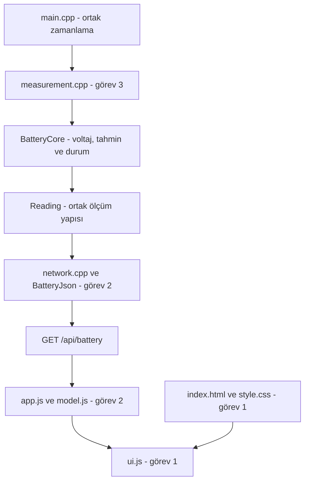

# battery-monitor

ESP32 tabanlı pil şarj ve izleme sistemi: voltaj, tahmini doluluk yüzdesi ve şarj durumunu web üzerinden görüntüleme. | ESP32-based battery charging and monitoring system with a web interface for voltage, estimated charge level, and charging status.

## Projenin şu anki durumu

Ortak klasörler, fonksiyon imzaları ve görev sınırları hazırdır. Kod dosyaları **TODO içeren başlangıç iskeletidir**; derlenmesi bitmiş ürün olduğu anlamına gelmez. Ağ, ölçüm ve ekran davranışlarını görev sahipleri tamamlar. Başlangıçta gerçek veya yapay pil verisi üretilmez.

| Görev | Branch | Ana dosyalar |
|---|---|---|
| Web arayüzü | `gorev/web-arayuzu` | `web/index.html`, `web/style.css`, `web/ui.js` |
| Wi-Fi ve web sunucusu | `gorev/wifi-ve-web-sunucusu` | `firmware/src/network.cpp`, `web/app.js`, `web/model.js`, `BatteryJson.*` |
| Pil ölçümü | `gorev/pil-olcumu` | `firmware/src/measurement.cpp`, `BatteryCore.*`, ölçüm ayarları |

## Önce oku

- [Dosya haritası](docs/DOSYA_HARITASI.md): her dosyanın sahibi ve yazılacak kod.
- [Fonksiyon sözleşmesi](docs/FONKSIYON_SOZLESMESI.md): dosyalar arasındaki çağrılar.
- [API sözleşmesi](docs/API.md): alanlar, durumlar ve geçersiz veri kuralları.
- [Donanım ve I/O](docs/DONANIM_VE_IO.md): başlangıç varsayımları ve onay bekleyen girişler.
- [GitHub çalışma düzeni](docs/GITHUB_CALISMA.md): klonlama, branch, commit ve PR.
- [Görev belgeleri](docs/gorevler/): üç kişiye özel PDF ve özetler.

## Bağlantı grafiği



Web dosyaları `firmware/scripts/embed_web.py` ile derleme sırasında gömülür. Ayrı PC backend, veritabanı, simülatör veya uygulama kurulmaz.

## Derleme

PlatformIO Core CLI ile repo kökünden:

```sh
pio run -d firmware
```

Bu komut yalnız iskeletin derlenmesini kontrol eder. Başlangıç `beginNetwork()` false döner, ölçüm örneği alınmaz ve JSON üreticisi tamamlanmamıştır. Çalışan ürün için görevlerin ve devre testlerinin bitmesi gerekir.

Yapı kontrolü: `python scripts/check_structure.py`. Bu, işlevsel test yerine geçmez.

ESP32 ilk sürümde kendi USB girişinden beslenir. Standart 1S Li-ion pil TP4056 üzerinden şarj edilir. Şarj akımı, koruma, GPIO bağlantıları ve ölçüm toprağı EE arkadaş tarafından onaylanır.

