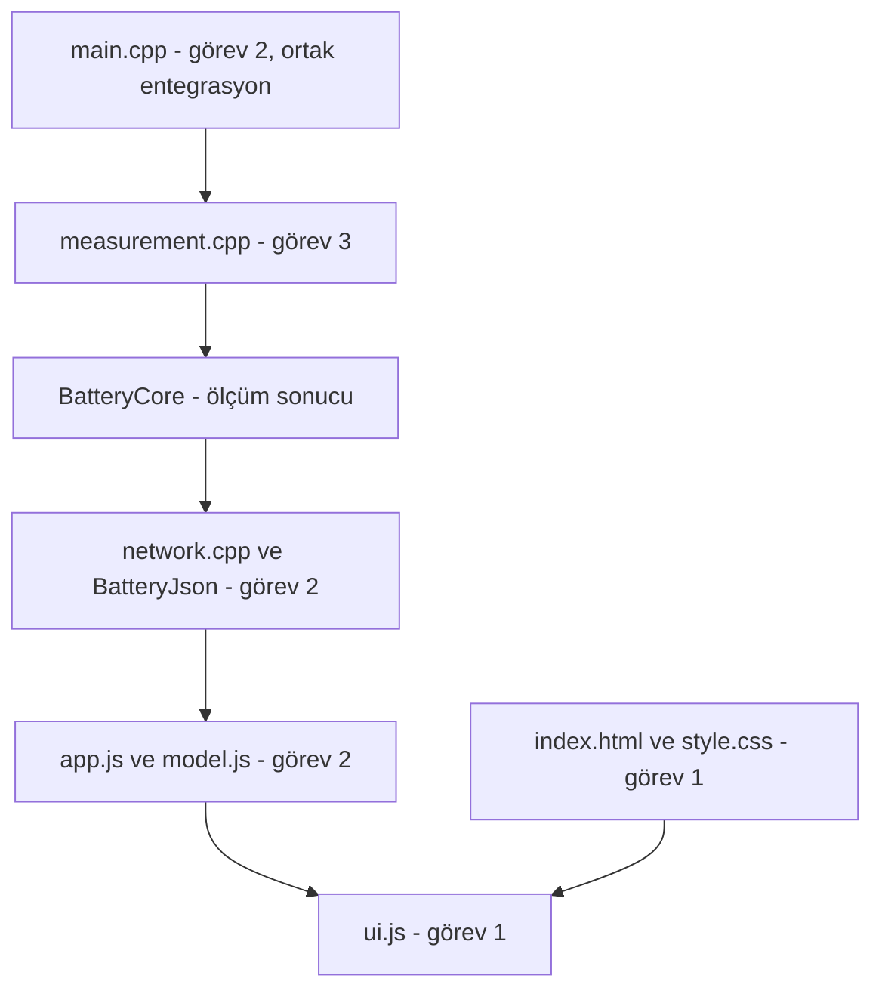

# battery-monitor

ESP32 tabanlı pil şarj ve izleme sistemi. Pil voltajını, tahmini doluluk yüzdesini ve şarj durumunu web üzerinden gösterme hedefi.

## Başlangıç

**Yalnız klasör yapısı ve görev belgeleri hazırdır. Kaynak kod dosyaları henüz yoktur; ekip üyeleri kendileri oluşturacaktır.** Boş klasörleri Git üzerinde tutan `.gitkeep` dosyalarının içinde kod yoktur.

- `web/`: 1. kişinin ekran dosyaları; 2. kişinin iletişim dosyaları.
- `firmware/src/`, `firmware/include/`: ESP32 uygulama dosyaları.
- `firmware/lib/BatteryCore/src/`: ölçüm çekirdeği ve JSON dönüştürme.
- `firmware/scripts/`: web gömme betiği, görev 2 oluşturacak.
- `scripts/`, `tests/`: ekipçe yazılacak yardımcı kontroller.
- `docs/gorevler/`: üç görev PDF’i ve özetleri.
- `docs/test-kayitlari/`: gerçek test ve kalibrasyon notları.

| Görev | Branch |
|---|---|
| Web arayüzü | `gorev/web-arayuzu` |
| Wi-Fi ve web sunucusu | `gorev/wifi-ve-web-sunucusu` |
| Pil ölçümü | `gorev/pil-olcumu` |

[Dosya haritası](docs/DOSYA_HARITASI.md) oluşturulacak tam dosya adlarını ve sahiplerini; [fonksiyon sözleşmesi](docs/FONKSIYON_SOZLESMESI.md) bağlantıları; [API sözleşmesi](docs/API.md) veri alanlarını gösterir. Belgelerdeki kaynak kod yolları henüz mevcut dosya değil, oluşturulacak dosyalardır.

Henüz derlenecek uygulama yoktur. PlatformIO dosyasını ve entegrasyon omurgasını görev 2, ölçüm arayüzünü görev 3 ile anlaşarak oluşturur. Herkes kendi branch’inde çalışır ve main’e pull request açar.
